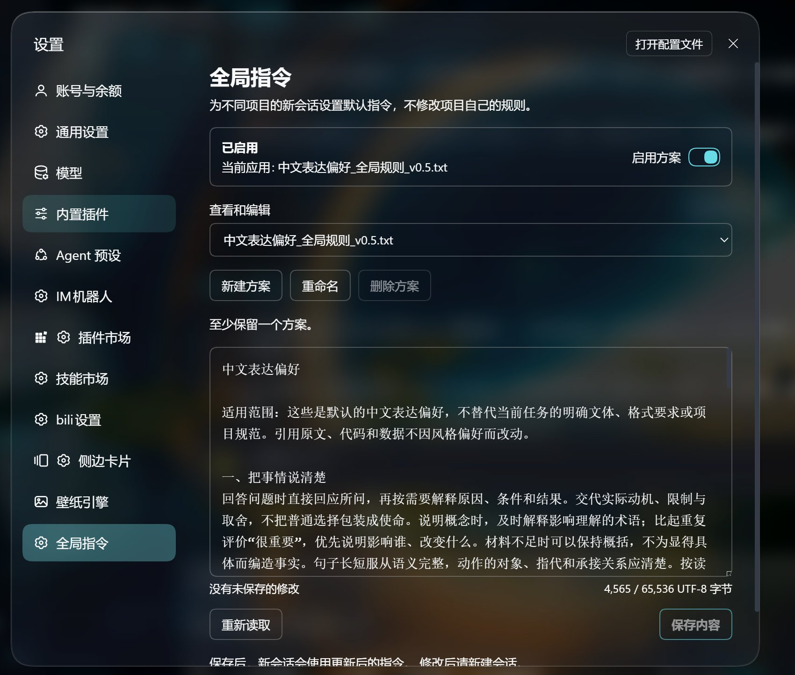

# DSH 全局指令 / Global instructions

为 DeepSeek Harness 保存多套全局指令，一次只应用一套。针对 DSH **0.2.2-rc.5** 开发，不需要额外 npm 包或安装脚本。



## 安装

从 [GitHub Releases](https://github.com/wuzeno/dsh-global-instructions/releases) 下载发布包。支持本地安装包的 DSH 可在插件管理器中选择下载的 `.tgz`；也可以下载源码 ZIP，解压后选择包含 `package.json` 的插件目录安装。安装后，打开「设置 → 全局指令」。本项目没有发布到 npm。

## 使用

打开「设置 → 全局指令」。可新建、编辑或重命名方案，也可以删除非当前选中的方案。正在编辑的方案和当前选中的方案彼此独立；查看、新建和保存其他方案都不会自动切换。关闭全局指令开关会暂停应用，重新开启后使用当前选中方案。支持中文、英文和明暗主题。

已有全局指令会作为默认方案显示。仅浏览不会创建或更改文件。插件把方案放在 `$DSH_HOME/.global-instructions-schemes.json`，把启用方案的内容写到 `$DSH_HOME/AGENTS.md`；未设置 `DSH_HOME` 时使用 `~/.dsh`。暂停时保留方案内容，将已生效的文件内容清空而不删除文件。不会改变项目规则、`~/.agents`、预设或插件配置。卸载保留两个文件，也不会自动恢复暂停前的内容。

通过公开的 `settings.section` 插槽添加独立设置页，不替换账户菜单，也不改动登录、退出或通知。

保存后**建议新建会话**以完整应用规则；不承诺改变已运行会话的上下文。规则不能覆盖系统、安全要求和更高优先级指令。

## 保存与边界

- 最多保存 16 套，每套最多 65,536 UTF-8 字节，计数按字节而非字符。其他全局规则也可能占用 DSH 的加载额度。
- 所有操作检查方案和文件版本。如果外部编辑过指令，插件不覆盖它，需重新读取后明确导入成新方案；外部删除则可确认暂停并保留所有方案。有未保存草稿时，请在重新读取前手动备份。
- 要同时更新方案和指令文件时，会先保存恢复记录。启动后按文件版本识别完成或中断；如果有无法判定的外部修改，停止写入，保留磁盘上的两个文件。遇到这种情况，先备份两个文件，勿删除方案文件；需将指令文件恢复到中断操作前或后的原始状态（包括是否存在）才能继续。
- 临时文件独占创建、同步、同目录重命名；不先删除原文件，不使用原地截断写入。失败保留草稿。
- 拒绝符号链接、目录、硬链接和非 UTF-8 文件。拒绝不安全的祖先路径。保存保留已有文件模式；Windows 上的权限还由父目录 ACL 决定。
- 插件内部保存按目标路径串行化。Node 的检查与重命名不是文件系统事务，无法绝对阻止第三方在最后检查与重命名间的极短竞争窗口；不对恶意本地进程作隔离承诺。
- HTTP 接口仅允许已认证 owner 访问，不暴露任意路径接口；写入必须为 JSON 请求：Web 校验同源，桌面端转发移除来源头时要求专用写入请求头；不开放跨站预检。请不要将未加保护的 DSH 实例公开到网络。
- 草稿保留在当前页面内存，切换设置项或关闭再打开设置时仍在。刷新、退出或卸载可能丢失草稿；不会把指令写入浏览器存储。

## 本地开发

```sh
npm test
```

用 DSH 插件管理器安装本目录，或通过其“安装包”功能安装发布后的 npm 包。不要手改 DSH 安装目录或 profile。插件没有构建步骤；浏览器模块使用宿主 React，Host 使用 Node 内置模块。

目录包含 Host HTTP 层、隔离的文件存储层、Client UI、单元测试和中英文元数据。测试使用独立临时目录，不读写真实全局指令。

## 兼容与许可

以 DSH 0.2.2-rc.5 为开发和验证基准；其他版本尚未逐个验证。使用 MIT 许可。

---

Open Settings → Global instructions to save multiple schemes, choose one to apply, or pause and resume it. Editing a different scheme does not activate it. The plugin keeps the scheme library in the current DSH home and projects only the active scheme into the global `AGENTS.md`. Project and shared instructions are untouched. Uninstalling leaves both files on disk. Start a new session after changes to the applied instructions. The editor supports Chinese and English; drafts stay in memory. The HTTP API is authenticated and owner-only.
